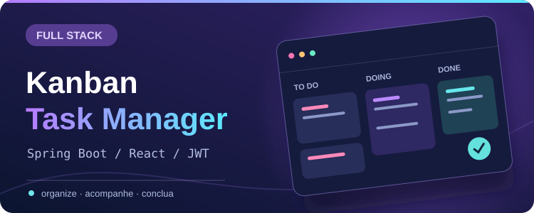
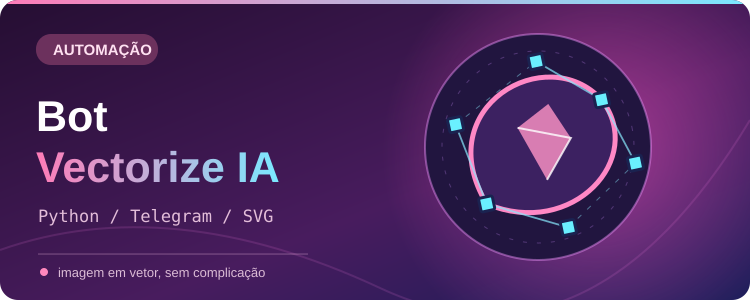
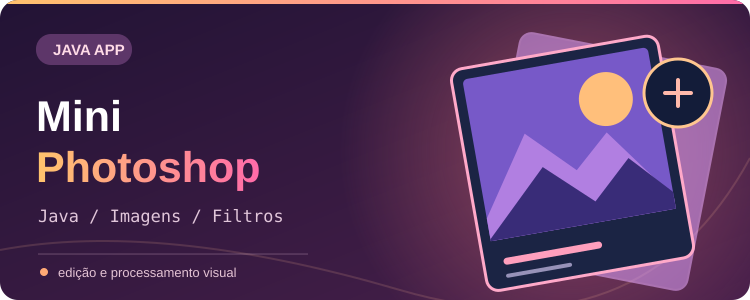

  

   
   

  
  
  

## 👋 Prazer, Ivanderson!

Sou de **Aurora, Ceará**, formado em **Ciência da Computação** e apaixonado por desenvolver soluções que funcionam de verdade. Meu foco é **back-end**, mas gosto de participar da construção completa de um produto: da lógica da API à experiência de quem usa.

Trabalho com **Java, Spring Boot e Python** e também exploro aplicações web, automações e interfaces com **React e TypeScript**.

## 🚀 Projetos que saíram do papel

<table>
  <tr>
    <td width="50%" valign="top">
      
      
Gerenciador full stack com autenticação, tarefas arrastáveis, dashboard e exportação em PDF.

      <a href="https://github.com/IvandersonDev/Kanban-Task-Manager-full-stack"><strong>Explorar o projeto ↗</strong></a>
    </td>
    <td width="50%" valign="top">
      
      
Bot para Telegram que recebe imagens e devolve arquivos vetorizados usando ferramentas de vetorização.

      <a href="https://github.com/IvandersonDev/bot-vectorize-IA"><strong>Explorar o projeto ↗</strong></a>
    </td>
  </tr>
  <tr>
    <td width="50%" valign="top">
      
      
Aplicativo para Android e Android TV com suporte a listas M3U e contas Xtream Codes.

      <a href="https://github.com/IvandersonDev/APP-IPTV"><strong>Explorar o projeto ↗</strong></a>
    </td>
    <td width="50%" valign="top">
      
      
Aplicação em Java para experimentar filtros e técnicas de processamento de imagens.

      <a href="https://github.com/IvandersonDev/MiniPhotoshop"><strong>Explorar o projeto ↗</strong></a>
    </td>
  </tr>
</table>

  <a href="https://github.com/IvandersonDev?tab=repositories"><strong>Conheça meus outros repositórios ↗</strong></a>

## ⚡ Minha stack

  
  &nbsp;
  
  &nbsp;
  
  &nbsp;
  
  &nbsp;
  
  &nbsp;
  
  &nbsp;
  

## 📊 Meu GitHub em movimento

  

## 💬 Vamos trocar uma ideia?

  
  
  
  

Feito com código, curiosidade e café. ☕

