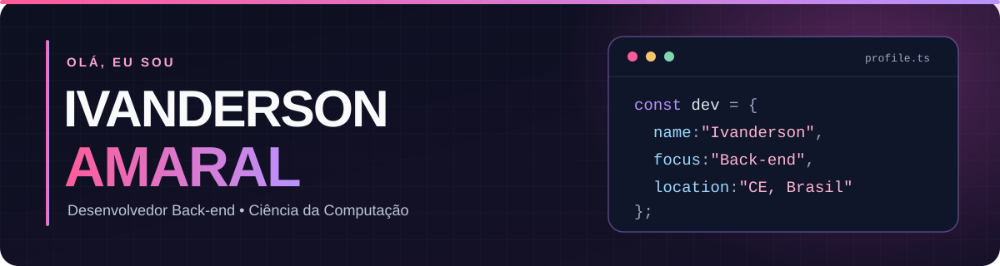

  

   

  
  
  

## 👨‍💻 Sobre mim

Sou **Ivanderson Amaral**, formado em **Ciência da Computação**, de **Aurora, Ceará**. Meu foco é o desenvolvimento **back-end**, e também construo projetos que envolvem interfaces web, automação e aplicações completas.

- 💻 Desenvolvimento com **Java, Spring Boot e Python**.
- 🧩 Experiência em projetos com **React, TypeScript e integração de APIs**.
- 🚀 Gosto de tirar ideias do papel e transformá-las em projetos funcionais.

## 🛠️ Tecnologias e ferramentas

  
<strong>Back-end</strong>

  
  
  

  
<strong>Front-end</strong>

  
  

  
<strong>Dados e versionamento</strong>

  
  
  

## ✨ Projetos em destaque

| Projeto | O que você encontra |
| :--- | :--- |
| **[Kanban Task Manager](https://github.com/IvandersonDev/Kanban-Task-Manager-full-stack)** | Gerenciador de tarefas full stack com **Spring Boot + React**, autenticação JWT, drag-and-drop e exportação em PDF. |
| **[Bot Vectorize IA](https://github.com/IvandersonDev/bot-vectorize-IA)** | Bot para **Telegram** que recebe imagens e devolve arquivos vetorizados, com integração ao Vectorizer.AI e VTracer. |
| **[BLACK PLUS TV](https://github.com/IvandersonDev/APP-IPTV)** | Aplicativo para **Android e Android TV** com suporte a listas M3U e contas Xtream Codes do usuário. |
| **[MiniPhotoshop](https://github.com/IvandersonDev/MiniPhotoshop)** | Aplicação em **Java** para processamento de imagens com diferentes filtros. |

  <a href="https://github.com/IvandersonDev?tab=repositories"><strong>Ver todos os repositórios →</strong></a>

## 📈 Atividade no GitHub

  

## 🤝 Vamos conversar?

  
  
  
  
  

  Obrigado pela visita! 👋

